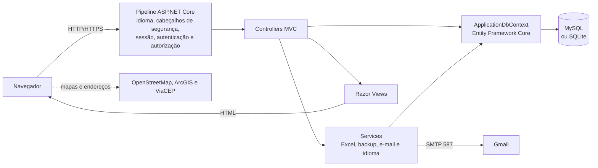

# InsEmpodera — Sistema de Gestão de Comunidades do Instituto Empodera

Aplicação web desenvolvida em ASP.NET Core MVC para apoiar o Instituto Empodera no registro e no acompanhamento de comunidades, atores sociais, recursos, atividades, diários de campo, fichas de primeiro contato e avaliações pessoais.

> **Contexto acadêmico:** projeto criado por estudantes da Fatec para o Instituto Empodera no segundo semestre de 2025, com orientação de Paula Rocha e Antonio Munari. Esta documentação foi revisada como entrega da Tarefa 09 — Documentação de Software, da disciplina de Integração e Entrega Contínua (DevOps).

> **Sistema publicado:** <https://ecoredes.org/Account> — **sistema fechado**, de uso exclusivo do Instituto Empodera. Veja [Acesso ao sistema publicado](#-acesso-ao-sistema-publicado-deploy).

## 📑 Sumário

- [Visão geral](#-visão-geral)
- [Acesso ao sistema publicado (deploy)](#-acesso-ao-sistema-publicado-deploy)
- [Funcionalidades](#-funcionalidades)
- [Escopo e limitações](#-escopo-e-limitações)
- [Requisitos](#-requisitos)
- [Tecnologias](#-tecnologias)
- [Arquitetura](#-arquitetura)
- [Estrutura do repositório](#-estrutura-do-repositório)
- [Como executar](#-como-executar)
- [Configuração](#-configuração)
- [Banco de dados](#-banco-de-dados)
- [Rotas, APIs e integrações](#-rotas-apis-e-integrações)
- [Testes](#-testes)
- [Integração contínua e deploy](#-integração-contínua-e-deploy)
- [Documentação complementar](#-documentação-complementar)
- [Trabalho escrito (ABNT)](#-trabalho-escrito-abnt)
- [Equipe](#-equipe)

## 🎯 Visão geral

### Problema

O trabalho de campo do Instituto Empodera envolve diversas comunidades, as pessoas e organizações que atuam nelas e os atendimentos realizados ao longo do tempo. Sem um sistema único, essas informações ficam dispersas em planilhas e anotações, o que dificulta consolidar o histórico de cada território, relacionar pessoas e recursos e produzir relatórios.

### Objetivo

Centralizar, em uma aplicação web com controle de acesso, o cadastro das comunidades e de seus vínculos, o registro das atividades de campo e o acompanhamento individual dos atores, permitindo consultar relatórios e exportar os dados em planilhas.

### Público-alvo

| Perfil | Uso principal |
| --- | --- |
| Equipe técnica e de campo do Instituto Empodera | Cadastra comunidades, atores, atividades, diários e fichas |
| Coordenação | Consulta relatórios, acompanha processos e exporta dados |
| Administração do sistema | Gerencia usuários, perfis de acesso, importações e backups |

O acesso é controlado por **perfis**. Os perfis `Admin`, `Editor`, `Colaborador`, `Visualizador` e `Supervisor` são criados inicialmente, e cada um possui permissões de listar, detalhar, criar, atualizar e excluir em cada módulo.

## 🌐 Acesso ao sistema publicado (deploy)

| | |
| --- | --- |
| **Endereço** | <https://ecoredes.org/Account> |
| **Nome na interface** | EcoRedes (InsEmpodera) |
| **Tipo de acesso** | Sistema **fechado** |

> **Sistema fechado:** o EcoRedes é de uso **exclusivo do Instituto Empodera**. Não há cadastro público: todas as páginas, exceto o login e a recuperação de senha, exigem autenticação, e as contas são criadas e gerenciadas pela administração do Instituto (módulo **Usuários**). Quem não é da equipe do Instituto não tem acesso ao sistema; por isso, a página abre na tela de login e não há dados públicos para consulta.

Para **avaliar o projeto sem acesso ao ambiente publicado**, execute-o localmente em modo de demonstração (SQLite, sem instalar banco): veja [Como executar](#-como-executar).

## ✨ Funcionalidades

| Módulo | O que permite fazer |
| --- | --- |
| Autenticação | Login por e-mail e senha, logout, bloqueio após tentativas inválidas e recuperação de senha por e-mail |
| Comunidades | Cadastro com endereço principal e secundário, mapa, situação (`Em diagnóstico` / `Em processo`) e desativação |
| Atores | Cadastro de pessoas vinculadas às comunidades, com recursos, vulnerabilidades e rede primária de relacionamentos |
| Recursos | Rede de recursos de cada comunidade, classificada por eixos temáticos |
| Atividades | Atividades por comunidade, com eixos e ações associadas |
| Diários de Campo | Registro de visitas com eixos, ações institucionais e atores envolvidos |
| Ficha de 1º Contato | Formulário em três etapas, com conclusão ou abandono do atendimento |
| Avaliação Pessoal | Avaliação de um ator por meio de indicadores pontuados |
| Diário Pessoal | Registro do processo pessoal de um ator, com eixos e menções a outros atores |
| Relatórios | RSC, Fichas de 1º Contato, Avaliações Pessoais, Ações e Rede Primária |
| Dados e Backup | Exportação de planilhas `.xlsx`, importação de planilhas de comunidade e backup geral |
| Usuários e perfis | Gestão de usuários, ativação/desativação e configuração de permissões por módulo |
| Idiomas | Interface em português, inglês e espanhol |

A descrição detalhada, com atores e situação de implementação de cada item, está em [docs/requisitos.md](docs/requisitos.md).

## 📐 Escopo e limitações

**Dentro do escopo:** aplicação web renderizada no servidor, para uso interno, com autenticação própria, persistência relacional, relatórios e importação/exportação em Excel.

**Fora do escopo atual:**

- API REST pública para integração com outros sistemas;
- aplicativo móvel ou funcionamento offline;
- migrations do Entity Framework — o esquema é criado pelo EF Core a partir do modelo (ver [Banco de dados](#-banco-de-dados));
- implantação automatizada — a publicação em servidor é manual.

**Limitações conhecidas:** não há migrations (o esquema vem do script [`Database/Empodera.schema.sql`](Database/Empodera.schema.sql)); e parte das verificações de permissão ainda depende da sessão HTTP. A lista completa está em [docs/requisitos.md](docs/requisitos.md#limitações-conhecidas).

## 📋 Requisitos

Resumo dos requisitos identificados no código. A especificação completa, com critérios verificáveis, está em [docs/requisitos.md](docs/requisitos.md).

| Código | Requisito funcional | Situação |
| --- | --- | --- |
| RF-001 | Autenticar usuários por e-mail e senha | Implementado |
| RF-002 | Recuperar a senha por link enviado por e-mail | Parcial — depende da configuração do Gmail |
| RF-003 | Gerenciar usuários e perfis de acesso por módulo | Implementado |
| RF-004 | Gerenciar comunidades e sua situação | Implementado |
| RF-005 | Gerenciar atores e seus vínculos | Implementado |
| RF-006 | Gerenciar recursos e atividades das comunidades | Implementado |
| RF-007 | Registrar diários de campo | Implementado |
| RF-008 | Registrar fichas de primeiro contato | Implementado |
| RF-009 | Registrar avaliações pessoais e diários pessoais | Implementado |
| RF-010 | Emitir relatórios | Implementado |
| RF-011 | Importar e exportar dados em Excel | Implementado |
| RF-012 | Alternar o idioma da interface | Implementado |

| Código | Requisito não funcional (principais) | Situação |
| --- | --- | --- |
| RNF-001 | Exigir autenticação em todas as rotas não públicas | Implementado |
| RNF-002 | Proteger formulários contra CSRF | Implementado |
| RNF-003 | Limitar tentativas de login e de recuperação de senha | Implementado |
| RNF-004 | Aplicar política de senha forte e armazenar senhas somente como hash | Implementado |
| RNF-007 | Não versionar credenciais nem dados pessoais reais | Parcial |
| RNF-010 | Executar onde houver o .NET 10 (Windows, Linux e macOS) | Atendido pela plataforma |
| RNF-012 | Executar testes automatizados a cada push | Implementado |
| RNF-014 | Desempenho adequado ao uso interno | Sem meta definida nem medição |

## 🧰 Tecnologias

| Camada | Tecnologia | Versão |
| --- | --- | --- |
| Plataforma | .NET / ASP.NET Core MVC | `net10.0` |
| Linguagem | C# | — |
| Acesso a dados | Entity Framework Core | 9.0.19 |
| Banco principal | MySQL 8.4 LTS ou posterior via `Pomelo.EntityFrameworkCore.MySql` | 9.0.0 (MySQL 8.4 LTS na CI) |
| Banco de demonstração | SQLite via `Microsoft.EntityFrameworkCore.Sqlite` | 9.0.19 |
| Autenticação | ASP.NET Core Identity com cookies | 9.0.19 |
| Planilhas | ExcelDataReader (leitura) e ClosedXML (escrita) | 3.8.0 / 0.105.0 |
| Relatórios em PDF | QuestPDF | 2026.9.1 |
| Contêineres | Docker e Docker Compose (aplicação + MySQL 8.4) | — |
| Interface | Razor Views, Bootstrap, jQuery, jQuery Validation | 5.3.3 / 3.7.1 / 1.21.0 |
| Mapas e gráficos | Leaflet, Leaflet Control Geocoder, Chart.js | 1.9.4 / — / 4.5.1 |
| Testes | xUnit, Microsoft.AspNetCore.Mvc.Testing, Playwright, Vitest | 2.9.3 / 9.0.19 / 1.62.0 / 3.2.7 |
| Qualidade | Stryker.NET (mutação) e CSharpier (formatação) | 4.16.0 / 1.3.0 |
| CI | GitHub Actions | — |

As versões foram conferidas em [`InsEmpodera.csproj`](InsEmpodera.csproj), nos projetos de teste, em [`Frontend.Tests/package.json`](Frontend.Tests/package.json), em [`.config/dotnet-tools.json`](.config/dotnet-tools.json), em [`dotnet-tools.json`](dotnet-tools.json) e nos arquivos de `wwwroot/lib`.

## 🧱 Arquitetura

O InsEmpodera é um **monólito ASP.NET Core MVC**. O servidor recebe a requisição, consulta o banco pelo Entity Framework Core e devolve páginas HTML renderizadas com Razor. Não há uma camada de API separada nem um frontend SPA.



| Componente | Responsabilidade |
| --- | --- |
| [`Program.cs`](Program.cs) | Registra serviços, banco, Identity, sessão, idiomas e limites de requisição; monta o pipeline HTTP |
| [`Controllers/`](Controllers/) | Recebem as requisições, verificam permissões, aplicam as regras e escolhem a view |
| [`Models/`](Models/) | Entidades persistidas, view models e extensões de permissão |
| [`Views/`](Views/) | Páginas Razor organizadas por controller |
| [`Data/`](Data/) | `ApplicationDbContext`, relacionamentos, dados iniciais e catálogo de eixos |
| [`Services/`](Services/) | Importação/exportação Excel, backup, Identity, e-mail e localização |
| [`Resources/`](Resources/) | Traduções `.resx` em pt-BR, en e es |
| [`wwwroot/`](wwwroot/) | CSS, JavaScript, imagens e bibliotecas de terceiros |

O fluxo completo de uma requisição, o fluxo de autenticação e as decisões técnicas estão em [docs/arquitetura.md](docs/arquitetura.md).

## 📁 Estrutura do repositório

```text
InsEmpodera/
├── .github/workflows/        # Pipelines do GitHub Actions
├── Controllers/              # Controllers MVC
├── Data/                     # DbContext, dados iniciais e catálogo de eixos
├── Database/                 # Scripts SQL auxiliares
├── Frontend.Tests/           # Testes de JavaScript e DOM (Vitest)
├── InsEmpodera.E2ETests/     # Jornadas no navegador (Playwright)
├── InsEmpodera.Tests/        # Testes de backend, integração e segurança (xUnit)
├── Models/                   # Entidades e view models
├── Properties/               # launchSettings.json
├── Resources/                # Traduções .resx
├── Services/                 # Serviços de aplicação
├── Views/                    # Páginas Razor
├── deploy/                   # Pacote publicado em 31/08/2026
├── docs/                     # Documentação técnica complementar
├── scripts/                  # Relatórios e diagnósticos dos testes (PowerShell)
├── wwwroot/                  # Arquivos estáticos e bibliotecas
├── Dockerfile                # Imagem da aplicação (.NET 10)
├── compose.yaml              # Aplicação + MySQL 8.4 com Docker Compose
├── .env.example              # Modelo das variáveis do Docker (copiar para .env)
├── InsEmpodera.csproj        # Projeto web
├── InsEmpodera.sln           # Solução com a aplicação e os testes
├── Program.cs                # Inicialização da aplicação
├── appsettings.json          # Configuração sem segredos
└── testar.ps1                # Executor dos testes de backend e banco
```

## 🚀 Como executar

Há três formas de rodar o projeto na sua máquina. Para **avaliar ou conhecer o sistema**, use a **Opção A** (a mais curta: não precisa instalar banco de dados).

| Opção | Banco | Quando usar | Tempo aproximado |
| --- | --- | --- | --- |
| **A — Demonstração** | SQLite (arquivo local) | Conhecer e avaliar o sistema | 5 min |
| **B — Desenvolvimento** | MySQL 8.4 | Desenvolver, equivalente à produção | 15 min |
| **C — Docker** | MySQL 8.4 em contêiner | Subir aplicação e banco juntos, sem instalar o .NET | 10 min |

### Pré-requisitos

| Ferramenta | Versão | Necessária para | Como conferir |
| --- | --- | --- | --- |
| [Git](https://git-scm.com/downloads) | recente | Todas as opções | `git --version` |
| [.NET SDK](https://dotnet.microsoft.com/download/dotnet/10.0) | **10.0** | Opções A e B | `dotnet --list-sdks` deve listar `10.0.x` |
| MySQL | 8.4 LTS (MariaDB **não** é compatível) | Opção B | `mysql --version` |
| Docker com Compose | recente | Opção C | `docker compose version` |
| Node.js e npm | 22.x | Somente testes de frontend | `node --version` |
| PowerShell | 7 ou superior | Somente `testar.ps1` | `pwsh --version` |

### Passo 1 — Baixar o código e compilar (todas as opções)

```bash
git clone -b Online https://github.com/Oroboni/InsEmpodera.git
cd InsEmpodera
dotnet restore InsEmpodera.sln
dotnet build InsEmpodera.sln
```

Resultado esperado: `Build succeeded` com **0 erros**. (Quem for usar apenas a Opção C pode pular a compilação.)

### Opção A — Demonstração com SQLite (recomendada para avaliação)

Não exige servidor de banco. No ambiente `Testing`, a aplicação cria o arquivo `Empodera.testing.db` na pasta do projeto, já com perfis, permissões, eixos temáticos e usuários de exemplo. A variável `Testing__AdminPassword` define a senha do administrador de exemplo: escolha qualquer valor.

**Passo 2 — Iniciar a aplicação**

macOS e Linux:

```bash
ASPNETCORE_ENVIRONMENT=Testing \
Testing__AdminPassword='EscolhaUmaSenha@123' \
dotnet run --no-launch-profile --urls "http://localhost:5000"
```

Windows (PowerShell):

```powershell
$env:ASPNETCORE_ENVIRONMENT = "Testing"
$env:Testing__AdminPassword = "EscolhaUmaSenha@123"
dotnet run --no-launch-profile --urls "http://localhost:5000"
```

> O parâmetro `--no-launch-profile` é obrigatório: sem ele, o `dotnet run` usa `Properties/launchSettings.json`, que força o ambiente `Development` (que exige MySQL).

**Passo 3 — Confirmar a inicialização.** O terminal deve exibir:

```text
Now listening on: http://localhost:5000
Hosting environment: Testing
```

**Passo 4 — Acessar.** Abra <http://localhost:5000> e entre com:

| Campo | Valor |
| --- | --- |
| E-mail | `joao@email.com` (usuário de exemplo do perfil `Admin`) |
| Senha | o valor definido em `Testing__AdminPassword` |

**Passo 5 — Conhecer o sistema.** Siga o [exemplo de uso](#exemplo-de-uso) abaixo.

**Para recomeçar do zero:** pare a aplicação (`Ctrl+C`) e apague o banco local:

```bash
rm -f Empodera.testing.db Empodera.testing.db-shm Empodera.testing.db-wal
```

> **Atenção:** o modo `Testing` afrouxa proteções (limite de tentativas de login, redirecionamento HTTPS e registro de dados sensíveis em log) e serve **apenas para demonstração local**. Nunca o utilize com dados reais.

### Opção B — Desenvolvimento com MySQL

Modo equivalente ao de produção. Use um servidor local e um banco **novo**.

**Passo 2 — Criar o banco e as tabelas (uma única vez).** Com o MySQL 8.4 em execução, crie o banco vazio e carregue o DDL oficial (cria as 34 tabelas, perfis, permissões e usuários de exemplo):

```bash
mysql -u root -p -e "CREATE DATABASE empodera CHARACTER SET utf8mb4;"
mysql -u root -p empodera -e "source Database/Empodera.schema.sql"
```

> Sem MySQL instalado, suba um temporário com Docker: `docker run -d --name mysql84 -p 3306:3306 -e MYSQL_ROOT_PASSWORD=SUA_SENHA mysql:8.4`.

**Passo 3 — Registrar a conexão e a senha inicial fora do repositório** (*user secrets*; nada disso vai para o Git). Execute na pasta do projeto:

```bash
dotnet user-secrets set "ConnectionStrings:DefaultConnection" "Server=127.0.0.1;Port=3306;Database=empodera;User=root;Password=SUA_SENHA;"
dotnet user-secrets set "Instalacao:SenhaAdmin" "EscolhaUmaSenha@123"
```

A senha inicial só é aplicada enquanto o usuário de ID 1 ainda tem a senha de fábrica do script; depois do primeiro acesso, remova-a com `dotnet user-secrets remove "Instalacao:SenhaAdmin"`.

**Passo 4 — Confiar no certificado HTTPS de desenvolvimento (uma única vez):**

```bash
dotnet dev-certs https --trust
```

**Passo 5 — Executar:**

```bash
dotnet run --launch-profile https
```

O terminal deve exibir `Now listening on: https://localhost:7121` e `Hosting environment: Development`. Na primeira execução, a aplicação garante os dez eixos temáticos.

**Passo 6 — Acessar.** Abra <https://localhost:7121> e entre com `joao@email.com` e a senha definida no passo 3.

### Opção C — Docker (aplicação + MySQL 8.4)

```bash
cp .env.example .env        # edite o .env e troque TODOS os valores (senhas do MySQL, SENHA_INICIAL_ADMIN etc.)
docker compose up -d --build
docker compose ps           # mysql "healthy" e app "Up"
```

Acesse <http://localhost:8080> e entre com `joao@email.com` e a `SENHA_INICIAL_ADMIN` definida no `.env`. Na primeira vez, o MySQL cria as tabelas com `Database/Empodera.schema.sql`. Os dados ficam em volumes e permanecem ao reiniciar; `docker compose down -v` apaga tudo. Detalhes (atualização, backup e restauração) em [docs/docker.md](docs/docker.md).

### Problemas comuns

| Sintoma | Solução |
| --- | --- |
| `You must install or update .NET to run this application` | Instale o **.NET 10** (SDK para compilar; runtime ASP.NET Core 10 para executar) |
| O ambiente `Testing` abre como `Development` | Inclua `--no-launch-profile` no `dotnet run` |
| `Defina ConnectionStrings__DefaultConnection...` | Você está fora do ambiente `Testing` sem MySQL configurado: refaça o passo 3 da Opção B ou use a Opção A |
| `Table 'empodera.Usuarios' doesn't exist` | O esquema não foi carregado: refaça o passo 2 da Opção B |
| Aviso de certificado em `https://localhost:7121` | Execute `dotnet dev-certs https --trust` |
| HTTP 400 `Invalid Hostname` | Acesse por `localhost` ou `127.0.0.1` |
| HTTP 429 ou "Acesso temporariamente bloqueado" no login | Aguarde 1 minuto (limite de tentativas) ou 15 minutos (cinco senhas erradas) |

A lista completa, as variáveis de ambiente e alternativas estão em [docs/instalacao-e-configuracao.md](docs/instalacao-e-configuracao.md).

### Exemplo de uso

1. Entre no sistema e abra **Comunidades** para cadastrar uma comunidade fictícia.
2. Em **Atores**, cadastre uma pessoa vinculada a essa comunidade.
3. Registre uma visita em **Diários de Campo** e um atendimento em **Ficha de 1º Contato**.
4. Consulte o resultado em **Relatórios** ou exporte a lista de comunidades em planilha pelo botão de exportação da tela **Comunidades**.

## 🔧 Configuração

A configuração segue o padrão do ASP.NET Core: `appsettings.json`, `appsettings.{Ambiente}.json`, *user secrets* em desenvolvimento e variáveis de ambiente no formato `Secao__Chave`. Nenhuma senha deve ser gravada em arquivos versionados.

| Chave / variável | Obrigatória | Finalidade | Exemplo fictício |
| --- | --- | --- | --- |
| `ASPNETCORE_ENVIRONMENT` | Sim | Ambiente: `Development`, `Testing` ou `Production` | `Development` |
| `DatabaseProvider` | Não | `MySql` (padrão) ou `Sqlite` (padrão apenas em `Testing`) | `MySql` |
| `ConnectionStrings__DefaultConnection` | Com MySQL | Conexão com o MySQL | `Server=127.0.0.1;Port=3306;Database=empodera;User=app;Password=...;` |
| `ConnectionStrings__TestConnection` | Não | Conexão SQLite; padrão `Data Source=Empodera.testing.db` | `Data Source=demo.db` |
| `Testing__AdminPassword` | Não | Senha aplicada ao usuário de ID 1, somente em `Testing` | `EscolhaUmaSenha@123` |
| `Email__User` | Sim | Remetente; o código aceita apenas `empodera.ajuda@gmail.com` | já definido em `appsettings.json` |
| `Email__Password` | Em produção | Senha de aplicativo do Gmail | definida no servidor |
| `Email__PublicBaseUrl` | Em produção | URL HTTPS pública usada nos links de recuperação | `https://exemplo.org` |
| `TEST_MYSQL_CONNECTION` | Para testes | Servidor MySQL usado pelos testes de backend e E2E | `Server=127.0.0.1;Port=3306;User=root;Password=...;` |

Detalhes e valores padrão: [docs/instalacao-e-configuracao.md](docs/instalacao-e-configuracao.md#variáveis-de-configuração). A configuração do Gmail está em [CONFIGURAR-GMAIL.md](CONFIGURAR-GMAIL.md).

## 💾 Banco de dados

- **Mapeamento:** Entity Framework Core com 34 entidades registradas em [`Data/ApplicationDbContext.cs`](Data/ApplicationDbContext.cs).
- **Provedores:** MySQL (8.4 LTS ou posterior) em desenvolvimento e produção; SQLite no modo de demonstração.
- **Criação do esquema:** não há migrations no repositório. O DDL oficial é [`Database/Empodera.schema.sql`](Database/Empodera.schema.sql), gerado a partir do modelo (`dotnet run --project scripts/GerarSchema`) conforme a [revisão técnica do DDL](docs/revisao-ddl-mysql.md). Bancos antigos (chaves UUID) são convertidos por [`Database/migracao-uuid-para-int.sql`](Database/migracao-uuid-para-int.sql). No ambiente `Testing` com SQLite, o EF Core cria as tabelas (`EnsureCreated`).
- **Dados iniciais:** perfis, permissões e cinco usuários de exemplo, criados junto com o esquema; os dez eixos temáticos são cadastrados na inicialização, em qualquer ambiente, caso estejam ausentes.
- **Chaves primárias:** `INT UNSIGNED AUTO_INCREMENT`, geradas pelo banco; restrições (FK, `UNIQUE`, `CHECK`) nomeadas no padrão da revisão do DDL.

O modelo de dados, os relacionamentos e os cuidados com os scripts estão em [docs/banco-de-dados.md](docs/banco-de-dados.md).

## 🔌 Rotas, APIs e integrações

O InsEmpodera **não expõe uma API REST pública**. As rotas seguem o padrão MVC `{controller=Home}/{action=Index}/{id?}` e retornam páginas HTML, redirecionamentos ou planilhas `.xlsx`. O Swagger está registrado nos ambientes `Development` e `Testing`, mas o documento gerado não contém operações.

| Serviço externo | Uso |
| --- | --- |
| Gmail SMTP (porta 587) | Envio dos links de recuperação de senha |
| OpenStreetMap (mapas e Nominatim) e ArcGIS | Exibição de mapas e busca de endereços, feitas pelo navegador |
| ViaCEP | Consulta de CEP no formulário de diário de campo |

As rotas por módulo e os endpoints que devolvem arquivos ou JSON estão em [docs/rotas-e-integracoes.md](docs/rotas-e-integracoes.md).

## 🧪 Testes

| Suíte | Ferramenta | Requer MySQL | Comando |
| --- | --- | :---: | --- |
| Backend, integração HTTP e segurança | xUnit | Sim | `dotnet test InsEmpodera.Tests/InsEmpodera.Tests.csproj` |
| Arquitetura e unidade (subconjunto) | xUnit | Não | ver [docs/testes.md](docs/testes.md#subconjunto-sem-banco) |
| Interface (JavaScript e DOM) | Vitest + jsdom | Não | `npm ci --prefix Frontend.Tests` e `npm test --prefix Frontend.Tests` |
| Jornadas no navegador | Playwright (Chromium) | Sim | `dotnet test InsEmpodera.E2ETests/InsEmpodera.E2ETests.csproj` |
| Backend e banco, com relatório | PowerShell | Sim | `./testar.ps1` |

Os testes de interface e navegador permanecem no repositório para execução manual, mas não são executados por `testar.ps1` nem pelos workflows de CI.

As suítes que usam banco criam e removem bancos temporários no servidor indicado por `TEST_MYSQL_CONNECTION`; o banco de desenvolvimento não é alterado. Instruções, cobertura e roteiro de validação manual: [docs/testes.md](docs/testes.md).

## 🔄 Integração contínua e deploy

**Link do deploy:** <https://ecoredes.org/Account> (sistema fechado, exclusivo do Instituto Empodera — ver [Acesso ao sistema publicado](#-acesso-ao-sistema-publicado-deploy)).

| Workflow | Gatilho | O que faz |
| --- | --- | --- |
| [`testes.yml`](.github/workflows/testes.yml) | Push e pull request em todas as branches, exceto `import_exel` | Executa `testar.ps1` com MySQL 8.4 LTS e publica os resultados como artefato |
| [`main.yml`](.github/workflows/main.yml) | Push na branch `import_exel` | Compila, testa e guarda o resultado de `dotnet publish` como artefato |
| [`qualidade-periodica.yml`](.github/workflows/qualidade-periodica.yml) | Domingos às 03h (UTC) ou execução manual | Executa testes de mutação com Stryker.NET |
| [`deploy-aws.yml`](.github/workflows/deploy-aws.yml) | Sucesso do `testes.yml` na `main`, ou execução manual | **CD:** entra na EC2 da AWS por SSH e roda `deploy/aws/atualizar.sh` (git pull + Docker Compose) |

**AWS (PI de Computação em Nuvem):** EC2 com Docker Compose, HTTPS pelo Amazon CloudFront, logs no Amazon CloudWatch e deploy automático pelo `deploy-aws.yml`. Arquitetura, segredos, IAM e limitações do AWS Academy em [docs/aws-producao.md](docs/aws-producao.md).

Implantação antiga (branch `Online`) — manual: o pacote gerado por `dotnet publish` é enviado a uma instância AWS EC2 com Nginx, systemd e MariaDB. O servidor novo (VPS Hostinger com Docker e MySQL 8.4) está em [docs/servidor-hostinger.md](docs/servidor-hostinger.md); a execução com Docker, em [docs/docker.md](docs/docker.md). O resumo está em [docs/deploy.md](docs/deploy.md), e o roteiro operacional completo, em [HOSPEDAGEM-AWS.md](HOSPEDAGEM-AWS.md).

## 📚 Documentação complementar

| Documento | Conteúdo |
| --- | --- |
| [docs/requisitos.md](docs/requisitos.md) | Requisitos funcionais e não funcionais, regras de negócio e limitações |
| [docs/arquitetura.md](docs/arquitetura.md) | Componentes, fluxo de requisição, autenticação, autorização e idiomas |
| [docs/instalacao-e-configuracao.md](docs/instalacao-e-configuracao.md) | Instalação detalhada, variáveis e solução de problemas |
| [docs/banco-de-dados.md](docs/banco-de-dados.md) | Entidades, relacionamentos, scripts e dados iniciais |
| [docs/revisao-ddl-mysql.md](docs/revisao-ddl-mysql.md) | Revisão técnica do DDL: o que mudou, checklist e migração dos dados |
| [docs/rotas-e-integracoes.md](docs/rotas-e-integracoes.md) | Rotas MVC, downloads, endpoints JSON e serviços externos |
| [docs/testes.md](docs/testes.md) | Suítes automatizadas, execução e validação manual |
| [docs/deploy.md](docs/deploy.md) | Pipelines, publicação e implantação |
| [docs/docker.md](docs/docker.md) | Docker (aplicação + MySQL 8.4): instalar, configurar, executar, atualizar, backup, restauração e migração |
| [docs/servidor-hostinger.md](docs/servidor-hostinger.md) | Servidor na Hostinger (VPS) com Docker e MySQL 8.4, passo a passo |
| [docs/seguranca-dados.md](docs/seguranca-dados.md) | Dados pessoais e credenciais: situação e plano para o histórico do Git |
| [TESTES.md](TESTES.md) | Matriz de cobertura CRUD |
| [InsEmpodera.E2ETests/README.md](InsEmpodera.E2ETests/README.md) | Detalhes da suíte Playwright |
| [CONFIGURAR-GMAIL.md](CONFIGURAR-GMAIL.md) | Configuração do envio de e-mails |
| [HOSPEDAGEM-AWS.md](HOSPEDAGEM-AWS.md) | Implantação na AWS |

## 📝 Trabalho escrito (ABNT)

O trabalho escrito do projeto, no padrão ABNT, está **em execução** e ficará disponível neste repositório assim que for concluído.

## 👥 Equipe

Composição atual da equipe responsável pelo projeto:

- Isadora Correa
- Matheus Cuero
- Maria Julia Loureiro
- Sophia Marcelino

O projeto foi iniciado no segundo semestre de 2025, com orientação de Paula Rocha e Antonio Munari. O histórico completo de contribuições permanece registrado nos commits do repositório.

