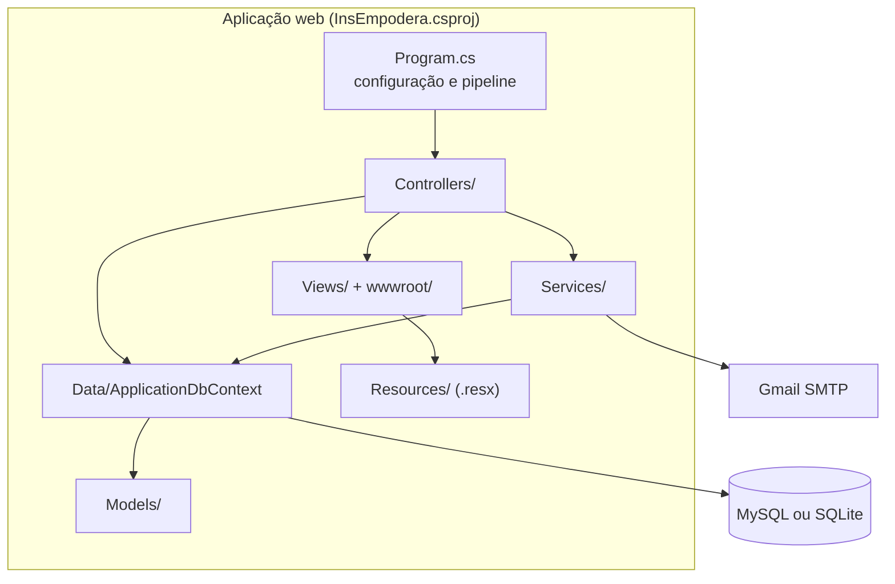
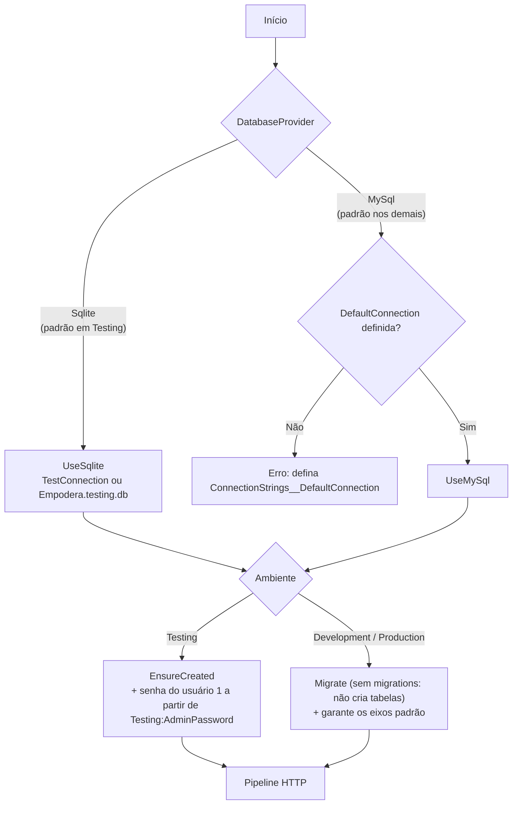
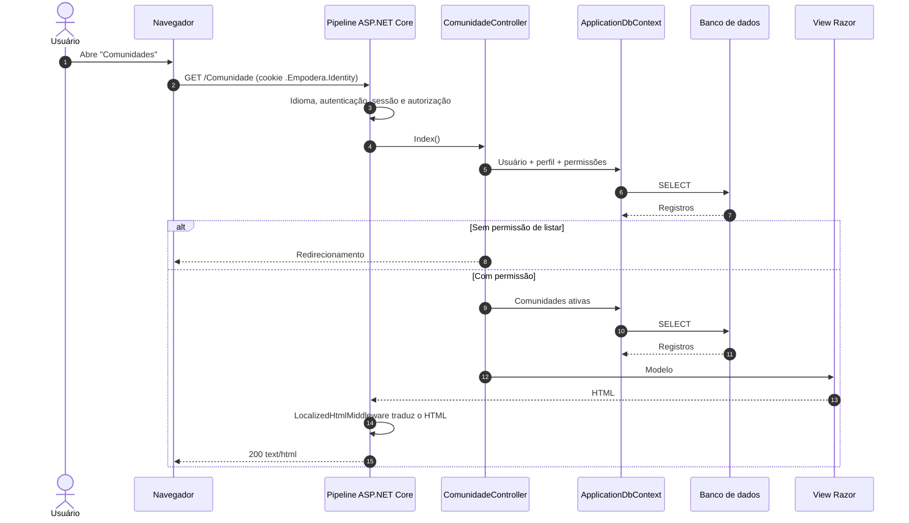
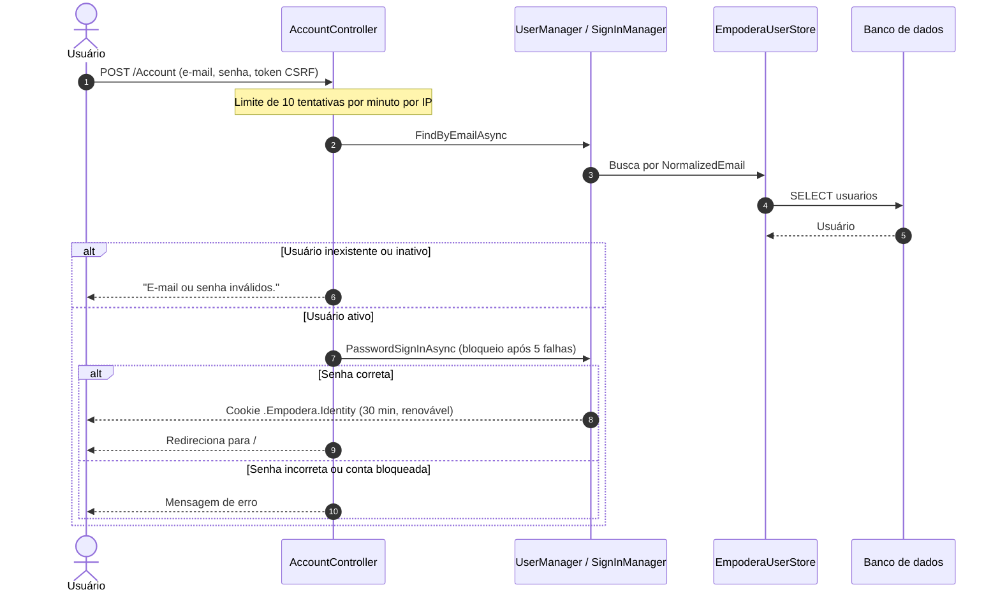
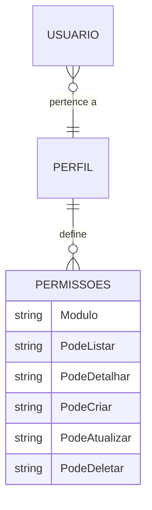

# Arquitetura do InsEmpodera

[← Voltar ao README principal](../README.md)

Este documento descreve a arquitetura como ela está implementada na branch `Online`. Os diagramas representam somente componentes e relações presentes no código.

## Sumário

- [Estilo arquitetural](#estilo-arquitetural)
- [Componentes](#componentes)
- [Inicialização da aplicação](#inicialização-da-aplicação)
- [Pipeline HTTP](#pipeline-http)
- [Fluxo de uma requisição](#fluxo-de-uma-requisição)
- [Autenticação e autorização](#autenticação-e-autorização)
- [Internacionalização](#internacionalização)
- [Decisões técnicas e consequências](#decisões-técnicas-e-consequências)

## Estilo arquitetural

O InsEmpodera é uma aplicação **monolítica** no padrão **MVC (Model–View–Controller)** do ASP.NET Core:

- **Model:** classes C# em `Models/`, mapeadas para tabelas pelo Entity Framework Core.
- **View:** páginas Razor (`.cshtml`) em `Views/`, renderizadas no servidor.
- **Controller:** classes em `Controllers/` que recebem a requisição, verificam permissões, aplicam as regras e escolhem a view.

Não existe camada de repositório nem projeto separado de domínio: os controllers usam o `ApplicationDbContext` diretamente. Operações mais extensas — planilhas, backup, e-mail e idioma — ficam em `Services/`.

## Componentes

| Pasta | Conteúdo principal |
| --- | --- |
| `Controllers/` | Um controller por área: `Account`, `Comunidade`, `Atores`, `Atividades`, `DiarioCampo`, `FichaPrimeiroContato`, `PersonalAssessment`, `PersonalProcess`, `Relatorios`, `Report`, `Services`, `Users`, `AccessProfile`, `Language`, `Ajuda`, `Configuracoes` e `Home` |
| `Models/` | Entidades (`Comunidade`, `Atores`, `DiarioCampo`, `FichaPrimeiroContato`, `Usuario`, `Perfil`, `Permissoes`…), view models e `UsuarioPermissionExtensions` |
| `Data/` | `ApplicationDbContext` (mapeamentos, dados iniciais e geração de chaves), `EixoCatalogo` (eixos padrão) e `ClassSeed` (classes auxiliares) |
| `Services/Identity/` | Adaptação do ASP.NET Core Identity à entidade `Usuario` (`EmpoderaUserStore`), claims e ponte com a sessão |
| `Services/Email/` | Envio assíncrono dos e-mails de recuperação pelo Gmail |
| `Services/` | `ExcelBackupService`, `SpreadsheetExportService`, `RelatorioExcelService`, `ExportComunidade`, `UserCultureService`, `LocalizedHtmlMiddleware` e utilitários |
| `Views/` | Uma pasta por controller, além de `Shared/` com os layouts `_Layout` e `_LoginLayout` |
| `wwwroot/` | CSS por página, scripts em `js/`, imagens e bibliotecas em `lib/` (Bootstrap, jQuery, Leaflet, Chart.js, Font Awesome) |

## Inicialização da aplicação

Ao iniciar, `Program.cs` escolhe o provedor de banco e prepara o esquema de acordo com o ambiente:

Consequência prática: fora do ambiente `Testing`, as tabelas precisam existir antes da primeira execução. Ver [banco-de-dados.md](banco-de-dados.md#criação-do-esquema).

## Pipeline HTTP

Ordem dos middlewares configurada em `Program.cs`:

| Ordem | Middleware | Função |
| :---: | --- | --- |
| 1 | `UseRequestLocalization` | Define o idioma pelo cookie ou pelo cabeçalho `Accept-Language` |
| 2 | Middleware de cabeçalhos | Adiciona CSP, `X-Frame-Options`, `X-Content-Type-Options`, `Referrer-Policy` e `Permissions-Policy` |
| 3 | `UseExceptionHandler` / `UseHsts` | Página de erro e HSTS fora de `Development` |
| 4 | `UseHttpsRedirection` | Redireciona para HTTPS, exceto em `Testing` |
| 5 | `UseStaticFiles` | Entrega os arquivos de `wwwroot/` |
| 6 | `UseRouting` | Seleciona a rota |
| 7 | `UseRateLimiter` | Aplica as políticas `login` e `password-recovery` |
| 8 | `LocalizedHtmlMiddleware` | Traduz o HTML gerado usando os arquivos `.resx` da view |
| 9 | `UseSession` | Habilita a sessão (expira após 4 horas sem uso) |
| 10 | `UseAuthentication` | Lê o cookie `.Empodera.Identity` |
| 11 | `IdentitySessionBridgeMiddleware` | Copia ID, e-mail e nome do usuário autenticado para a sessão |
| 12 | Swagger | Disponível apenas em `Development` e `Testing` |
| 13 | `UseAuthorization` | Exige usuário autenticado em rotas não públicas |
| 14 | `MapControllerRoute` | Rota padrão `{controller=Home}/{action=Index}/{id?}` |

## Fluxo de uma requisição

Exemplo: um usuário autenticado abre a listagem de comunidades (`GET /Comunidade`).

Operações de escrita seguem o mesmo caminho por `POST`, com validação do token antifalsificação antes de chegar ao controller e redirecionamento ao final (padrão *Post/Redirect/Get*).

## Autenticação e autorização

### Autenticação

A autenticação usa o **ASP.NET Core Identity** com cookies, adaptado à tabela `usuarios` existente por meio de `EmpoderaUserStore`. Não há tabelas `AspNet*`.

A cada requisição, o cookie é revalidado: se o usuário for desativado ou se o `SecurityStamp` mudar (por exemplo, após redefinir a senha), a sessão é encerrada.

### Autorização

A autorização acontece em duas camadas:

1. **Global:** uma política padrão exige usuário autenticado em todas as rotas. As ações públicas — login, recuperação de senha e troca de idioma — usam `[AllowAnonymous]`.
2. **Por módulo:** cada ação consulta o perfil do usuário e suas permissões e chama `CanList`, `CanViewDetails`, `CanCreate`, `CanUpdate` ou `CanDelete` (`Models/UsuarioPermissionExtensions.cs`). Usuários inativos não recebem nenhuma permissão.

## Internacionalização

- Idiomas: `pt-BR` (padrão), `en` e `es`.
- O idioma vem do cookie de cultura ou, na ausência dele, do cabeçalho `Accept-Language` do navegador.
- As traduções ficam em `Resources/SharedResource.*.resx` e em um arquivo por controller e idioma em `Resources/Controllers/`.
- O `LocalizedHtmlMiddleware` traduz o HTML já renderizado; o endpoint `GET /Language/Catalog` fornece o mesmo catálogo em JSON para os scripts do navegador.

## Decisões técnicas e consequências

| Decisão observada | Consequência |
| --- | --- |
| Renderização no servidor com Razor, sem API | Implantação simples (um único processo), mas sem integração programática com outros sistemas |
| Dois provedores de banco (MySQL e SQLite) no mesmo `DbContext` | Permite demonstração sem servidor de banco; exige atenção a diferenças de SQL entre provedores |
| Esquema MySQL mantido por script SQL, sem migrations | Evolução do banco manual, com scripts incrementais em `Database/` |
| Chaves primárias inteiras aleatórias (100000–999999) geradas pela aplicação | Identificadores menos previsíveis nas URLs; o espaço de chaves é limitado por tabela |
| Identity adaptado à tabela `usuarios` existente | Preserva os dados legados e ganha hash de senha, bloqueio e tokens de redefinição |
| Sessão mantida em paralelo ao cookie de autenticação | Compatibilidade com o código legado; a sessão é sempre derivada da identidade autenticada |
