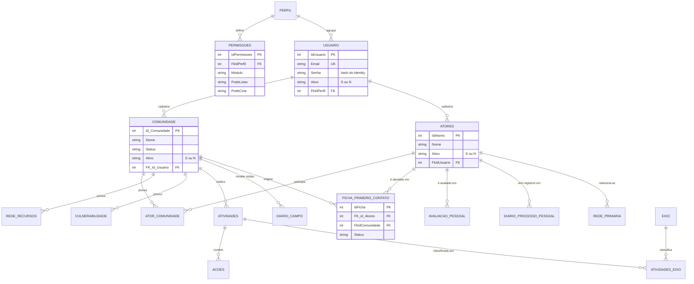

# Banco de dados

[← Voltar ao README principal](../README.md)

Este documento descreve a persistência do InsEmpodera conforme [`Data/ApplicationDbContext.cs`](../Data/ApplicationDbContext.cs) e [`Program.cs`](../Program.cs).

## Sumário

- [Visão geral](#visão-geral)
- [Modelo de dados](#modelo-de-dados)
- [Entidades](#entidades)
- [Geração de chaves primárias](#geração-de-chaves-primárias)
- [Dados iniciais](#dados-iniciais)
- [Criação do esquema](#criação-do-esquema)
- [Scripts SQL do repositório](#scripts-sql-do-repositório)
- [Backup e preservação de dados](#backup-e-preservação-de-dados)

## Visão geral

| Item | Implementação |
| --- | --- |
| ORM | Entity Framework Core 9.0.19 |
| Contexto | `Empodera.Data.ApplicationDbContext` (um único `DbContext`, 34 entidades) |
| Provedor de produção e desenvolvimento | MySQL/MariaDB via `Pomelo.EntityFrameworkCore.MySql` 9.0.0, com detecção automática da versão do servidor |
| Provedor de demonstração | SQLite via `Microsoft.EntityFrameworkCore.Sqlite` 9.0.19 |
| Seleção do provedor | Chave `DatabaseProvider` (`MySql` ou `Sqlite`) |
| Migrations | Não existem no repositório (foram removidas no commit `38efd15`) |
| Versões de banco | MariaDB 10.4.32 na CI; pacote `mariadb105-server` (MariaDB 10.5) no servidor descrito em [HOSPEDAGEM-AWS.md](../HOSPEDAGEM-AWS.md) |

## Modelo de dados

Diagrama simplificado com as entidades centrais e seus relacionamentos, conforme as configurações do `OnModelCreating`. Tabelas de associação com eixos e os detalhes internos das fichas e diários foram omitidos para legibilidade.

## Entidades

| Domínio | Entidade (classe) | Tabela | Finalidade |
| --- | --- | --- | --- |
| Acesso | `Usuario` | `Usuarios` | Contas de acesso, com os campos exigidos pelo ASP.NET Core Identity |
| Acesso | `Perfil` | `Perfis` | Perfis de acesso |
| Acesso | `Permissoes` | `Permissoes` | Permissões por perfil e módulo (`S`/`N` para cada ação) |
| Comunidade | `Comunidade` | `Comunidades` | Comunidades atendidas, com endereços, mapa e situação |
| Comunidade | `RedeRecursos` | `RedeRecursos` | Recursos disponíveis na comunidade |
| Comunidade | `Vulnerabilidade` | `Vulnerabilidades` | Vulnerabilidades identificadas na comunidade |
| Atores | `Atores` | `Atores` | Pessoas acompanhadas ou parceiras |
| Atores | `AtorComunidade` | `AtorComunidades` | Associação N:N entre atores e comunidades |
| Atores | `RecursosAtores` | `RecursosAtores` | Recursos e vulnerabilidades associados a um ator |
| Atores | `RedePrimaria` | `RedesPrimarias` | Relação entre dois atores, com o tipo de relação |
| Atores | `FonteInf` | `FontesInfo` | Fontes de informação vinculadas a um ator e a uma ficha |
| Atividades | `Atividades` | `Atividades` | Atividades realizadas em uma comunidade |
| Atividades | `Acoes`, `AcoesAtores` | `Acoes`, `AcoesAtores` | Ações de uma atividade e atores envolvidos |
| Diário de campo | `DiarioCampo` | `DiariosCampo` | Registros de visita |
| Diário de campo | `DiarioAcoes`, `DiarioDAcoes`, `DetalhesDAcoes`, `DAAtores`, `AnexosDiario` | tabelas homônimas | Ações, detalhes, atores e anexos do diário |
| Ficha de 1º contato | `FichaPrimeiroContato` | `FichasPrimeiroContato` | Ficha de atendimento inicial |
| Ficha de 1º contato | `FichaCondicoes`, `FichaPeticoes`, `FichaResp`, `FichaResult` | `FichaCondicoes`, `FichaPeticoes`, `FichaRespostas`, `FichaResultados` | Itens de múltipla escolha da ficha |
| Acompanhamento | `AvaliacaoPessoal` | `AvaliacaoPessoal` | Nove indicadores pontuados de 1 a 5 |
| Acompanhamento | `DiarioProcessoPessoal` | `diariosprocessopessoal` | Diário do processo pessoal de um ator |
| Eixos | `Eixo` | `Eixos` | Catálogo de eixos temáticos |
| Eixos | `RedeEixo`, `AtividadesEixo`, `DiarioEixo`, `DetalhesEixos`, `VulnerabilidadesEixo`, `DiarioProcessoEixo` | `RedeEixos`, `AtividadesEixo`, `DiarioEixos`, `DetalhesEixos`, `VulnerabilidadesEixo`, `diariosprocessoeixos` | Associação de eixos a recursos, atividades, diários e vulnerabilidades |

Os nomes de tabela criados pelo EF Core seguem os nomes das propriedades `DbSet`. Em servidores MySQL/MariaDB no Linux, nomes de tabela diferenciam maiúsculas de minúsculas; por isso, um dump gerado no Windows (nomes em minúsculas) precisa de ajuste, como descrito em [HOSPEDAGEM-AWS.md](../HOSPEDAGEM-AWS.md).

### Regras de exclusão

- A maior parte dos relacionamentos usa exclusão em cascata: excluir uma ficha, um diário ou uma atividade remove seus registros filhos.
- Relacionamentos com `Restrict` impedem a exclusão: usuário → perfil, usuário que modificou um registro (`FkIdUsuarioM`) e rede primária → atores.
- Comunidades, atores e usuários não são apagados pela interface; recebem `Ativo = "N"`.

## Geração de chaves primárias

O `ApplicationDbContext` sobrescreve `SaveChanges` e `SaveChangesAsync` para atribuir, antes da gravação, uma chave inteira aleatória entre **100000 e 999999** a cada novo registro sem chave definida. A aplicação confere se a chave já existe e tenta até 128 vezes antes de falhar. Os registros iniciais usam chaves fixas (1, 2, 3…).

## Dados iniciais

| Dado | Origem | Quando é criado |
| --- | --- | --- |
| Perfis `Admin`, `Editor`, `Colaborador`, `Visualizador` e `Supervisor` | `HasData` no `ApplicationDbContext` | Na criação do esquema pelo EF Core |
| 60 permissões (12 módulos × 5 perfis) | `HasData` | Na criação do esquema pelo EF Core |
| Cinco usuários de exemplo (`joao@email.com` e `u2@example.com` a `u5@example.com`; os dois últimos inativos) | `HasData` | Na criação do esquema pelo EF Core |
| Dez eixos temáticos | `Data/EixoCatalogo.cs` | A cada inicialização em `Development`/`Production`, somente os que estiverem ausentes |

Os usuários de exemplo são fictícios. A senha deles não é publicada: no ambiente `Testing`, a senha do usuário de ID 1 é definida por `Testing:AdminPassword`.

## Criação do esquema

Como não há migrations, `Database.MigrateAsync()` (chamado fora do ambiente `Testing`) não cria tabelas. O esquema é criado de uma destas formas:

| Situação | Como criar | Validado nesta revisão |
| --- | --- | --- |
| Demonstração com SQLite | Executar no ambiente `Testing`; `EnsureCreated` cria o arquivo e as tabelas | Sim |
| Banco MySQL/MariaDB novo | Executar uma vez no ambiente `Testing` com `DatabaseProvider=MySql` (ver [instalação, opção B](instalacao-e-configuracao.md#opção-b--desenvolvimento-com-mysql-ou-mariadb)) | Sim, em MySQL 9.7.1 |
| Banco MySQL/MariaDB a partir de script | Importar `Database/Empodera.schema.sql` (somente exemplo) ou `Banco.txt` (dados da equipe) | Sim, em MySQL 9.7.1 |
| Testes automatizados | Cada teste cria um banco temporário `insempodera_*` com `EnsureCreated` e o apaga ao final | Sim, em MySQL 9.7.1 |
| Servidor de produção | Importação de um dump do banco existente, conforme [HOSPEDAGEM-AWS.md](../HOSPEDAGEM-AWS.md) | Não |

`EnsureCreated` não altera um banco que já tenha tabelas. Ao iniciar em `Development`, o EF Core também cria a tabela vazia `__EFMigrationsHistory`, sem efeito sobre os dados. Mudanças futuras no modelo precisam de scripts SQL incrementais, como o já existente em `Database/`, e da atualização de `Database/Empodera.schema.sql`.

## Scripts SQL do repositório

| Arquivo | Conteúdo | Situação |
| --- | --- | --- |
| [`Banco.txt`](../Banco.txt) | `DROP DATABASE`, criação de 34 tabelas, dados da equipe e restrições | Compatível com o modelo; importado sem erros em MySQL 9.7.1 e usado pela aplicação nesta revisão. Tabelas em minúsculas. Também é lido pelo teste `IdentityDatabaseContractTests`, que confere as colunas do Identity |
| [`Database/Empodera.schema.sql`](../Database/Empodera.schema.sql) | Esquema gerado pelo EF Core a partir do modelo atual, para MariaDB 10.4.32, com os dados de exemplo fictícios | Importado sem erros em MySQL 9.7.1 nesta revisão; não apaga bancos existentes |
| [`Database/20260830_adicionar_endereco_secundario_comunidades.sql`](../Database/20260830_adicionar_endereco_secundario_comunidades.sql) | Adiciona `LocalSecundario` e `LocalMapaSecundario` em `Comunidades` | Script incremental para bancos existentes |

> **Cuidado:** `Banco.txt` apaga o banco `empodera` antes de recriá-lo. Não o execute em servidores com dados.

## Backup e preservação de dados

- **Pela aplicação:** usuários `Admin` podem gerar o backup geral em `.xlsx` (`/Services/ExportBackupGeral`) e importá-lo em **Dados e Backup**. A importação insere apenas registros ausentes e preserva os existentes.
- **Pelo banco:** o procedimento com `mariadb-dump` e a restauração no servidor estão em [HOSPEDAGEM-AWS.md](../HOSPEDAGEM-AWS.md).
- **Arquivos locais:** `Empodera.testing.db` e os arquivos auxiliares do SQLite (`*.db-shm`, `*.db-wal`) estão no `.gitignore` e não devem ser versionados.
- **Dados pessoais:** registros reais de comunidades e pessoas não devem ser publicados no repositório nem usados em ambientes de teste.
