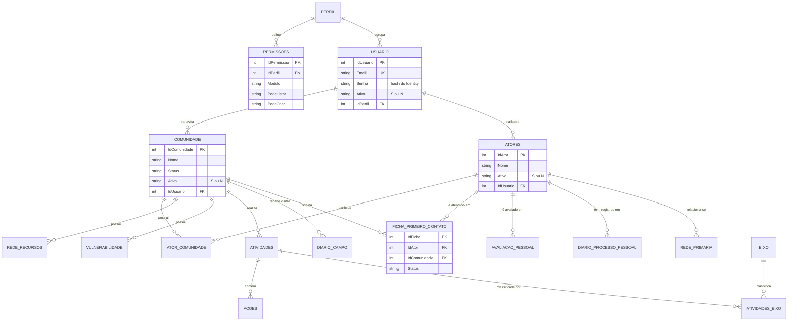

# Banco de dados

[← Voltar ao README principal](../README.md)

Este documento descreve a persistência do InsEmpodera conforme [`Data/ApplicationDbContext.cs`](../Data/ApplicationDbContext.cs), [`Data/ApplicationDbContext.Esquema.cs`](../Data/ApplicationDbContext.Esquema.cs) e [`Program.cs`](../Program.cs).

O esquema segue a **revisão técnica do DDL** feita pelo orientador; o que mudou e por quê está em [revisao-ddl-mysql.md](revisao-ddl-mysql.md).

## Sumário

- [Visão geral](#visão-geral)
- [Modelo de dados](#modelo-de-dados)
- [Entidades](#entidades)
- [Geração de chaves primárias](#geração-de-chaves-primárias)
- [Dados iniciais](#dados-iniciais)
- [Criação do esquema](#criação-do-esquema)
- [Scripts SQL do repositório](#scripts-sql-do-repositório)
- [Backup e preservação de dados](#backup-e-preservação-de-dados)

## Visão geral

| Item | Implementação |
| --- | --- |
| ORM | Entity Framework Core 9.0.19 |
| Contexto | `Empodera.Data.ApplicationDbContext` (um único `DbContext`, 34 entidades) |
| Provedor de produção e desenvolvimento | MySQL 8.4 LTS ou posterior via `Pomelo.EntityFrameworkCore.MySql` 9.0.0, com detecção automática da versão do servidor |
| Provedor de demonstração | SQLite via `Microsoft.EntityFrameworkCore.Sqlite` 9.0.19 |
| Seleção do provedor | Chave `DatabaseProvider` (`MySql` ou `Sqlite`) |
| Migrations | Não existem no repositório (foram removidas no commit `38efd15`) |
| Versões de banco | **MySQL 8.4 LTS** em todos os ambientes (CI e servidor novo, ver [servidor-hostinger.md](servidor-hostinger.md)); também validado com MySQL 9.7.1. O servidor antigo descrito em [HOSPEDAGEM-AWS.md](../HOSPEDAGEM-AWS.md) usa MariaDB 10.5, que não é compatível (o collation `utf8mb4_0900_ai_ci` não existe no MariaDB) |

## Modelo de dados

Diagrama simplificado com as entidades centrais e seus relacionamentos, conforme as configurações do `OnModelCreating`. Tabelas de associação com eixos e os detalhes internos das fichas e diários foram omitidos para legibilidade.

## Entidades

| Domínio | Entidade (classe) | Tabela | Finalidade |
| --- | --- | --- | --- |
| Acesso | `Usuario` | `Usuarios` | Contas de acesso, com os campos exigidos pelo ASP.NET Core Identity |
| Acesso | `Perfil` | `Perfis` | Perfis de acesso |
| Acesso | `Permissoes` | `Permissoes` | Permissões por perfil e módulo (`S`/`N` para cada ação) |
| Comunidade | `Comunidade` | `Comunidades` | Comunidades atendidas, com endereços, mapa e situação |
| Comunidade | `RedeRecursos` | `RedeRecursos` | Recursos disponíveis na comunidade |
| Comunidade | `Vulnerabilidade` | `Vulnerabilidades` | Vulnerabilidades identificadas na comunidade |
| Atores | `Atores` | `Atores` | Pessoas acompanhadas ou parceiras |
| Atores | `AtorComunidade` | `AtorComunidades` | Associação N:N entre atores e comunidades |
| Atores | `RecursosAtores` | `RecursosAtores` | Recursos e vulnerabilidades associados a um ator |
| Atores | `RedePrimaria` | `RedesPrimarias` | Relação entre dois atores, com o tipo de relação |
| Atores | `FonteInf` | `FontesInfo` | Fontes de informação vinculadas a um ator e a uma ficha |
| Atividades | `Atividades` | `Atividades` | Atividades realizadas em uma comunidade |
| Atividades | `Acoes`, `AcoesAtores` | `Acoes`, `AcoesAtores` | Ações de uma atividade e atores envolvidos |
| Diário de campo | `DiarioCampo` | `DiariosCampo` | Registros de visita |
| Diário de campo | `DiarioAcoes`, `DiarioDAcoes`, `DetalhesDAcoes`, `DAAtores`, `AnexosDiario` | tabelas homônimas | Ações, detalhes, atores e anexos do diário |
| Ficha de 1º contato | `FichaPrimeiroContato` | `FichasPrimeiroContato` | Ficha de atendimento inicial |
| Ficha de 1º contato | `FichaCondicoes`, `FichaPeticoes`, `FichaResp`, `FichaResult` | `FichaCondicoes`, `FichaPeticoes`, `FichaRespostas`, `FichaResultados` | Itens de múltipla escolha da ficha |
| Acompanhamento | `AvaliacaoPessoal` | `AvaliacaoPessoal` | Nove indicadores pontuados de 1 a 5 |
| Acompanhamento | `DiarioProcessoPessoal` | `diariosprocessopessoal` | Diário do processo pessoal de um ator |
| Eixos | `Eixo` | `Eixos` | Catálogo de eixos temáticos |
| Eixos | `RedeEixo`, `AtividadesEixo`, `DiarioEixo`, `DetalhesEixos`, `VulnerabilidadesEixo`, `DiarioProcessoEixo` | `RedeEixos`, `AtividadesEixo`, `DiarioEixos`, `DetalhesEixos`, `VulnerabilidadesEixo`, `diariosprocessoeixos` | Associação de eixos a recursos, atividades, diários e vulnerabilidades |

As tabelas têm nomes em minúsculas (no MySQL para Linux os nomes diferenciam maiúsculas de minúsculas), definidos no `ApplicationDbContext`. As colunas do banco seguem o padrão da revisão (chave no singular, FK com o nome da PK referenciada, sem prefixo `Fk`); as propriedades C# mantiveram os nomes antigos e o mapeamento está em `ApplicationDbContext.Esquema.cs`. A lista de colunas renomeadas está em [revisao-ddl-mysql.md](revisao-ddl-mysql.md#6-nomenclatura-e-nomeação-de-restrições).

### Regras de exclusão

- A maior parte dos relacionamentos usa exclusão em cascata: excluir uma ficha, um diário ou uma atividade remove seus registros filhos.
- Relacionamentos com `Restrict` impedem a exclusão: usuário → perfil, usuário que modificou um registro (`IdUsuarioModificacao`), autor do diário pessoal e rede primária → atores.
- `SET NULL`: criador do perfil e ator da fonte de informação.
- Todas as 57 chaves estrangeiras têm nome explícito; a lista completa com a regra de cada uma está em [revisao-ddl-mysql.md](revisao-ddl-mysql.md#regra-on-delete-de-cada-fk).
- Comunidades, atores e usuários não são apagados pela interface; recebem `Ativo = "N"`.

## Geração de chaves primárias

Todas as tabelas usam `INT UNSIGNED AUTO_INCREMENT`: o banco gera a chave no `INSERT` e o EF a lê de volta. A aplicação não gera Ids. Quando um registro novo precisa ser referenciado antes de salvo (por exemplo, um ator criado dentro da Rede Primária), o código liga as entidades pela navegação e o EF preenche a FK ao gravar. Os registros iniciais usam chaves fixas (1, 2, 3…).

## Dados iniciais

| Dado | Origem | Quando é criado |
| --- | --- | --- |
| Perfis `Admin`, `Editor`, `Colaborador`, `Visualizador` e `Supervisor` | `HasData` no `ApplicationDbContext` | Na criação do esquema pelo EF Core |
| 60 permissões (12 módulos × 5 perfis) | `HasData` | Na criação do esquema pelo EF Core |
| Cinco usuários de exemplo (`joao@email.com` e `u2@example.com` a `u5@example.com`; os dois últimos inativos) | `HasData` | Na criação do esquema pelo EF Core |
| Dez eixos temáticos | `Data/EixoCatalogo.cs` | A cada inicialização em `Development`/`Production`, somente os que estiverem ausentes |

Os usuários de exemplo são fictícios. A senha deles não é publicada: no ambiente `Testing`, a senha do usuário de ID 1 é definida por `Testing:AdminPassword`.

## Criação do esquema

Não há migrations do EF. O esquema oficial é o script [`Database/Empodera.schema.sql`](../Database/Empodera.schema.sql), **gerado a partir do modelo** por `dotnet run --project scripts/GerarSchema`.

| Situação | Como criar | Validado nesta revisão |
| --- | --- | --- |
| Demonstração com SQLite | Executar no ambiente `Testing`; `EnsureCreated` cria o arquivo e as tabelas a partir do modelo | Sim |
| Banco MySQL novo | `CREATE DATABASE empodera;` e executar `Database/Empodera.schema.sql` nele | Sim, em MySQL 8.4.11 e 9.7.1 |
| Banco atual (chaves UUID) | Migrar com `Database/migracao-uuid-para-int.sql` ([passo a passo](revisao-ddl-mysql.md#migração-dos-dados)) | Sim, com o dump da equipe |
| Testes automatizados | Cada teste cria um banco temporário `insempodera_*` **executando `Empodera.schema.sql`** e o apaga ao final | Sim, em MySQL 8.4.11 e 9.7.1 |

Ao mudar o modelo (`ApplicationDbContext*.cs`), rode o gerador e versione os dois scripts; o teste `RevisaoDdlTests` falha se eles estiverem desatualizados. Bancos já em uso precisam de um script incremental para a mudança.

## Scripts SQL do repositório

| Arquivo | Conteúdo | Situação |
| --- | --- | --- |
| [`Database/Empodera.schema.sql`](../Database/Empodera.schema.sql) | DDL oficial: 34 tabelas, restrições nomeadas e os dados de exemplo fictícios | Gerado pelo `scripts/GerarSchema`; não apaga bancos existentes nem desliga a verificação de FKs |
| [`Database/migracao-uuid-para-int.sql`](../Database/migracao-uuid-para-int.sql) | Copia os dados do banco antigo (`empodera_antigo`, chaves UUID) para o novo | Gerado pelo `scripts/GerarSchema`; para sem gravar nada se encontrar problemas |
| [`Database/20260830_adicionar_endereco_secundario_comunidades.sql`](../Database/20260830_adicionar_endereco_secundario_comunidades.sql), [`Database/20261016_adicionar_tipo_rede_redes_primarias.sql`](../Database/20261016_adicionar_tipo_rede_redes_primarias.sql) | Colunas adicionadas ao esquema antigo | Só para preparar um banco antigo antes da migração |

## Backup e preservação de dados

- **Pela aplicação:** usuários `Admin` podem gerar o backup geral em `.xlsx` (`/Services/ExportBackupGeral`) e importá-lo em **Dados e Backup**. A importação insere apenas registros ausentes e preserva os existentes.
- **Pelo banco:** use `mysqldump` (o procedimento antigo com `mariadb-dump` está em [HOSPEDAGEM-AWS.md](../HOSPEDAGEM-AWS.md)). Backups em `.xlsx` gerados antes da troca para chaves inteiras não são compatíveis com o esquema novo.
- **Arquivos locais:** `Empodera.testing.db` e os arquivos auxiliares do SQLite (`*.db-shm`, `*.db-wal`) estão no `.gitignore` e não devem ser versionados.
- **Dados pessoais:** registros reais de comunidades e pessoas não devem ser publicados no repositório nem usados em ambientes de teste.
