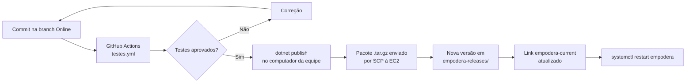
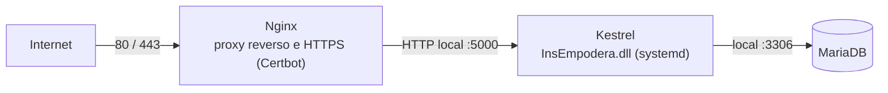

# Integração contínua, publicação e deploy

[← Voltar ao README principal](../README.md)

Este documento resume como o InsEmpodera é validado, empacotado e implantado. O roteiro operacional completo, com todos os comandos do servidor, está em [HOSPEDAGEM-AWS.md](../HOSPEDAGEM-AWS.md).

## Sumário

- [Fluxo de entrega](#fluxo-de-entrega)
- [Branches](#branches)
- [Pipelines do GitHub Actions](#pipelines-do-github-actions)
- [Gerar o pacote de publicação](#gerar-o-pacote-de-publicação)
- [Ambiente de produção](#ambiente-de-produção)
- [Implantação e rollback](#implantação-e-rollback)
- [Cuidados de segurança](#cuidados-de-segurança)

## Fluxo de entrega



A integração contínua é automatizada; a **implantação é manual**. Nenhum workflow acessa o servidor.

## Branches

| Branch | Uso observado |
| --- | --- |
| `Online` | Desenvolvimento ativo e origem das publicações descritas em `HOSPEDAGEM-AWS.md` |
| `main` | Branch padrão do GitHub; não recebe as alterações recentes |
| `develop`, `import_exel` e outras | Branches de trabalho anteriores |

## Pipelines do GitHub Actions

| Workflow | Gatilho | Resultado |
| --- | --- | --- |
| [`testes.yml`](../.github/workflows/testes.yml) | Push e pull request em todas as branches, exceto `import_exel`/`Import_exel`; manual | Executa backend, interface e E2E com MariaDB 10.4.32; artefatos `resultados-testes-*` por 14 dias |
| [`main.yml`](../.github/workflows/main.yml) | Push em `import_exel`; pull request para `Import_exel` | `restore`, `build`, `test` e `dotnet publish`; artefato `app` |
| [`qualidade-periodica.yml`](../.github/workflows/qualidade-periodica.yml) | Domingos às 03h (UTC); manual | Testes de mutação com Stryker.NET |

As senhas usadas nos workflows (`MYSQL_ROOT_PASSWORD`) pertencem apenas aos contêineres temporários do MariaDB criados durante cada execução.

## Gerar o pacote de publicação

Comando usado para produzir a versão publicada (dependente do runtime instalado no servidor):

```bash
dotnet publish InsEmpodera.csproj --configuration Release --output publish --no-self-contained
```

A pasta `publish/` deve conter `InsEmpodera.dll`, `InsEmpodera.runtimeconfig.json` e `wwwroot/`. O diretório [`deploy/`](../deploy) do repositório guarda um pacote gerado em 31/08/2026; ele é um artefato de build e não precisa ser usado para executar o projeto a partir do código-fonte.

## Ambiente de produção

Arquitetura descrita em [HOSPEDAGEM-AWS.md](../HOSPEDAGEM-AWS.md):



| Item | Configuração |
| --- | --- |
| Servidor | AWS EC2 com Amazon Linux |
| Runtime | `aspnetcore-runtime-9.0` |
| Processo | Serviço systemd `empodera`, escutando somente em `127.0.0.1:5000` |
| Banco | MariaDB local, banco `empodera` com usuário próprio da aplicação |
| Configuração | Arquivo `/etc/empodera/empodera.env`, legível apenas pelo `root`, com `ASPNETCORE_ENVIRONMENT=Production`, conexão do banco e variáveis `Email__*` |
| Uploads | Pasta persistente fora das versões, ligada a `wwwroot/uploads` |

## Implantação e rollback

Resumo do procedimento (comandos completos nas seções 8 a 16 de [HOSPEDAGEM-AWS.md](../HOSPEDAGEM-AWS.md)):

1. Atualizar a branch `Online` e executar `testar.ps1`.
2. Gerar o pacote com `dotnet publish` e compactá-lo em `.tar.gz`.
3. Enviar o pacote ao servidor por `scp`.
4. Extrair em `~/empodera-releases/<versão>` e validar a presença da DLL e dos arquivos estáticos.
5. Apontar o link `~/empodera-current` para a nova versão e reiniciar o serviço `empodera`.
6. Validar serviços, portas, HTTP/HTTPS e login.

**Rollback:** apontar `~/empodera-current` para a versão anterior e reiniciar o serviço. O rollback não desfaz alterações feitas no banco; por isso, gere um backup do MariaDB antes de cada publicação.

**Atualização de esquema:** como não há migrations, alterações de estrutura precisam de scripts SQL incrementais aplicados manualmente, como [`Database/20260830_adicionar_endereco_secundario_comunidades.sql`](../Database/20260830_adicionar_endereco_secundario_comunidades.sql).

## Cuidados de segurança

- Em produção, use sempre `ASPNETCORE_ENVIRONMENT=Production`. O ambiente `Testing` amplia limites de login, desativa o redirecionamento HTTPS, registra dados sensíveis em log e, com `Testing__AdminPassword` definido, redefine a senha do usuário de ID 1 a cada inicialização.
- Em produção, a aplicação só inicia com `Email__Password` e uma `Email__PublicBaseUrl` HTTPS válidas.
- Credenciais ficam somente no arquivo de ambiente do servidor ou em cofres de segredos — nunca no repositório.
- Ajuste `AllowedHosts` para o nome público do sistema quando ele for acessado por um domínio.
