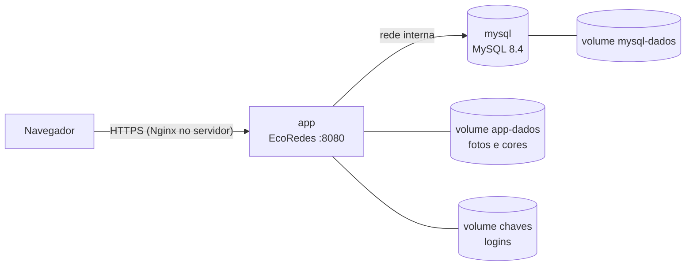

# EcoRedes com Docker (aplicação + MySQL 8.4)

[← Voltar ao README principal](../README.md)

Como instalar, configurar, executar, atualizar, fazer backup, restaurar e migrar os dados do EcoRedes com
Docker. É o mesmo procedimento no computador da equipe e no servidor da Hostinger
([servidor-hostinger.md](servidor-hostinger.md)).

| Arquivo | Papel |
| --- | --- |
| [`Dockerfile`](../Dockerfile) | Imagem da aplicação (.NET 10), roda como usuário sem privilégios |
| [`compose.yaml`](../compose.yaml) | Aplicação + MySQL 8.4, com volumes persistentes |
| [`.env.example`](../.env.example) | Modelo das configurações; o `.env` real nunca vai para o Git |
| [`scripts/backup.sh`](../scripts/backup.sh) | Backup do banco e das fotos/cores |
| [`scripts/restaurar.sh`](../scripts/restaurar.sh) | Restauração de um backup |
| [`scripts/migrar-dados.sh`](../scripts/migrar-dados.sh) | Migração do banco antigo (UUID) com relatório e critérios de aceite |



## 1. Instalar

Requisitos: Docker Engine com o plugin Compose (`docker compose version`).

```bash
git clone https://github.com/Oroboni/InsEmpodera.git
cd InsEmpodera
cp .env.example .env
```

## 2. Configurar

Edite o `.env` e troque **todos** os valores. Gere senhas fortes com `openssl rand -base64 24`.

| Variável | Uso |
| --- | --- |
| `MYSQL_ROOT_PASSWORD`, `MYSQL_PASSWORD` | Senhas do MySQL (administração e aplicação) |
| `APP_URL_PUBLICA`, `APP_DOMINIO` | Endereço HTTPS e domínio aceitos pela aplicação (no computador: `https://localhost` e `localhost`) |
| `EMAIL_SENHA` | Senha de aplicativo do Gmail para "Esqueci minha senha" |
| `SENHA_INICIAL_ADMIN` | Só em instalação nova: senha do administrador (usuário 1). Apague depois do primeiro acesso |

O `.env` está no `.gitignore`. Nenhuma senha fica no repositório nem na imagem.

## 3. Executar

```bash
docker compose up -d --build
docker compose ps                    # mysql "healthy" e app "Up"
```

Acesse `http://localhost:8080` (no servidor, pelo domínio, via Nginx). Na primeira vez, o MySQL cria as 34 tabelas
executando `Database/Empodera.schema.sql`; isso só acontece com o volume do banco vazio.

**Instalação nova:** entre com `joao@email.com` e a `SENHA_INICIAL_ADMIN`, troque a senha e apague a variável do `.env`.
A senha inicial só é aplicada enquanto o usuário 1 tem a senha de fábrica — nunca sobrescreve uma senha real.

**Dados persistentes:** banco, fotos/cores e chaves de login ficam em volumes nomeados. Continuam lá depois de
`docker compose restart`, `docker compose down` / `up` e de atualizações. Só `docker compose down -v` apaga os volumes.

Comandos úteis:

```bash
docker compose logs -f app           # registros da aplicação
docker compose restart               # reiniciar
docker compose down                  # parar (os dados ficam)
```

## 4. Atualizar

```bash
scripts/backup.sh                    # sempre antes
git pull
docker compose up -d --build         # recria só o que mudou; os volumes são mantidos
```

Se a versão nova mudar o esquema do banco, ela traz um script incremental em `Database/`; aplique-o antes de subir
a versão nova. Para voltar atrás: `git checkout <versão anterior>`, `docker compose up -d --build` e, se o banco
tiver mudado, restaure o backup (seção 6).

## 5. Backup

```bash
scripts/backup.sh                    # grava em backups/: banco-<data>.sql.gz e app-data-<data>.tar.gz
```

O script confere se os dois arquivos podem ser lidos e apaga backups com mais de 14 dias (`DIAS_RETENCAO`).
No servidor, agende todo dia e copie a pasta `backups/` para fora do servidor:

```bash
echo "30 2 * * * root cd /opt/ecoredes && scripts/backup.sh >> /var/log/ecoredes-backup.log 2>&1" | sudo tee /etc/cron.d/ecoredes-backup
```

## 6. Restaurar

```bash
scripts/restaurar.sh backups/banco-<data>.sql.gz backups/app-data-<data>.tar.gz
```

Pede confirmação (digitar `RESTAURAR`), para a aplicação, substitui o banco e as fotos/cores e inicia de novo.

## 7. Migrar os dados do servidor antigo

1. **Backup da base antiga** (no servidor atual, com a aplicação parada):

   ```bash
   mariadb-dump --single-transaction --hex-blob --default-character-set=utf8mb4 empodera | gzip > base-antiga.sql.gz
   tar czf app-data-antigo.tar.gz -C <pasta da aplicação> App_Data
   ```

2. No ambiente novo, suba o compose (seção 3) **sem** usar o sistema ainda e rode:

   ```bash
   scripts/migrar-dados.sh base-antiga.sql.gz app-data-antigo.tar.gz
   ```

O script guarda uma cópia do dump em `backups/`, importa a base em `empodera_antigo`, migra, compara e grava um
relatório em `backups/relatorio-migracao-<data>.txt`. Se a verificação encontrar problemas nos dados antigos,
nada é gravado: corrija em `empodera_antigo`, apague o banco novo (`docker compose down -v`) e recomece.

## 8. Critérios de aceite

| Etapa | Critério | Como verificar |
| --- | --- | --- |
| Criação do banco | 34 tabelas; 34 PK, 57 FK, 47 CHECK, 14 UNIQUE; nenhum erro | `docker compose up` num volume vazio; testes `RevisaoDdlTests` |
| Persistência | Dados, fotos e login continuam após `restart` e após `down`/`up` | criar registro, reiniciar, conferir |
| Migração | Nenhum problema na verificação; mesma quantidade de registros por tabela (exceto vínculos repetidos, listados); restrições ativas; nenhuma menção com UUID | relatório do `scripts/migrar-dados.sh` (falha se algum critério não for atendido) |
| Funcionamento | Login, listagens, cadastro, menções viram links, fotos aparecem, três idiomas | conferência manual no navegador |
| Backup | Arquivos gerados e legíveis | `scripts/backup.sh` (confere sozinho) |
| Restauração | Após apagar dados de teste, a restauração devolve banco e fotos | `scripts/restaurar.sh` e conferência no navegador |

**Validação feita pela equipe (27/10/2026, MySQL 8.4.11 em Docker):** todos os critérios acima foram atendidos com a
última cópia da base disponível no repositório (283 atores, 24 comunidades, 44 fichas…), incluindo
reinício, recriação dos contêineres, backup, perda simulada e restauração. Falta repetir com uma cópia recente da
base de produção e no servidor da Hostinger.
