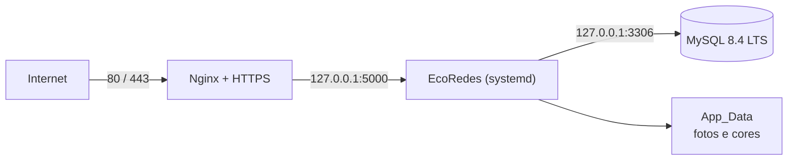

# Servidor na Hostinger (VPS KVM 1) com MySQL 8.4 LTS

[← Voltar ao README principal](../README.md)

Roteiro para montar o servidor novo do EcoRedes numa VPS da Hostinger e trazer os dados do servidor
atual (MariaDB 10.5). Segue a regra da revisão técnica do DDL: **MySQL 8.4 LTS em todos os ambientes**.

| Item | Escolha |
| --- | --- |
| Plano | Hostinger VPS KVM 1 (1 vCPU, 4 GB de RAM, disco NVMe) |
| Sistema | Ubuntu 24.04 LTS (imagem limpa, sem painel) |
| Banco | MySQL 8.4 LTS, só acessível de dentro do servidor |
| Aplicação | ASP.NET Core 10 (Kestrel) como serviço `systemd`, em `127.0.0.1:5000` |
| Acesso público | Nginx com HTTPS (Let's Encrypt) nas portas 80/443 |
| Backup | `mysqldump` + pasta `App_Data` todos os dias, guardados por 14 dias |



> Os comandos abaixo usam `<...>` para valores que vocês escolhem (senhas, domínio). Nunca coloque senhas
> reais no repositório.

---

## 1. Pedido na Hostinger

- **Localização:** a mais próxima do público principal do sistema.
- **Sistema operacional:** Ubuntu 24.04 LTS, sem modelo de aplicação.
- **Acesso:** cadastre uma chave SSH (mais seguro que senha).
- **Backups automáticos da Hostinger:** opcionais. O backup diário do banco da seção 9 não depende deles.
- **Domínio:** aponte um registro `A` do domínio (ex.: `ecoredes.org`) para o IP da VPS.

## 2. Primeiro acesso e segurança básica

```bash
ssh root@<ip-da-vps>

apt update && apt upgrade -y
adduser equipe                      # usuário de administração
usermod -aG sudo equipe
rsync -a ~/.ssh /home/equipe && chown -R equipe:equipe /home/equipe/.ssh

ufw allow OpenSSH
ufw allow 'Nginx Full'              # (depois de instalar o Nginx; ver seção 6)
ufw enable
timedatectl set-timezone America/Sao_Paulo
```

A partir daqui, entre como `ssh equipe@<ip-da-vps>` e use `sudo`.

## 3. MySQL 8.4 LTS

O Ubuntu 24.04 traz o MySQL 8.0 nos repositórios padrão; o 8.4 LTS vem do **repositório oficial do MySQL**:

```bash
cd /tmp
wget https://dev.mysql.com/get/mysql-apt-config_0.8.36-1_all.deb   # confira a versão mais recente em dev.mysql.com/downloads/repo/apt
sudo dpkg -i mysql-apt-config_*_all.deb                            # na tela, escolha "mysql-8.4-lts"
sudo apt update
sudo apt install -y mysql-server
mysql --version                                                    # deve mostrar 8.4.x
sudo mysql_secure_installation
```

Confirme que o MySQL só escuta dentro do servidor e registre a versão (item 1 do checklist da revisão):

```bash
sudo ss -ltnp | grep 3306           # deve mostrar 127.0.0.1:3306
sudo mysql -e "SELECT VERSION();"
```

Banco e usuário da aplicação (o usuário só enxerga o banco `empodera`):

```sql
-- sudo mysql
CREATE DATABASE empodera;
CREATE USER 'empodera_app'@'localhost' IDENTIFIED BY '<senha-forte-do-banco>';
GRANT SELECT, INSERT, UPDATE, DELETE, CREATE TEMPORARY TABLES ON empodera.* TO 'empodera_app'@'localhost';
FLUSH PRIVILEGES;
```

Crie as tabelas com o DDL oficial (enviado junto com a aplicação, seção 5):

```bash
sudo mysql empodera < /opt/empodera/releases/<versao>/Database/Empodera.schema.sql
```

> Se a migração da seção 4 for feita, ela usa este banco recém-criado. Não inicie a aplicação antes dela.

## 4. Trazer os dados do servidor atual

O servidor atual usa MariaDB 10.5 e as chaves antigas (UUID). O caminho é: copiar o banco atual para a VPS,
importar como `empodera_antigo` e rodar a migração.

**No servidor atual** (avise a equipe e pare a aplicação para ninguém gravar durante a cópia):

```bash
sudo systemctl stop empodera
mariadb-dump --single-transaction --default-character-set=utf8mb4 empodera > empodera-antigo.sql
tar czf app-data-antigo.tar.gz -C ~/empodera-current App_Data 2>/dev/null || true
scp empodera-antigo.sql app-data-antigo.tar.gz equipe@<ip-da-vps>:/tmp/
```

**Na VPS:**

```bash
sudo mysql -e "CREATE DATABASE empodera_antigo;"
sudo mysql empodera_antigo < /tmp/empodera-antigo.sql
```

Se a importação reclamar de alguma função só do MariaDB em valores padrão de coluna (por exemplo
`UUID_v4()`), troque-a no arquivo antes de importar: a migração só lê os dados.

```bash
sed -i "s/UNHEX(REPLACE(UUID_v4(), '-', ''))/UUID_TO_BIN(UUID())/g" /tmp/empodera-antigo.sql
```

Se o banco atual não tiver as colunas `LocalSecundario`, `LocalMapaSecundario` ou `TipoRede`, aplique antes
os scripts `Database/2026*.sql` em `empodera_antigo`.

Rode a migração:

```bash
sudo mysql < /opt/empodera/releases/<versao>/Database/migracao-uuid-para-int.sql
```

- Se aparecer uma lista de **problemas**, nada foi gravado: corrija os registros apontados em
  `empodera_antigo` e rode de novo.
- No fim, o script mostra a lista "Nome antigo / Nome novo" dos usuários. Use-a para renomear as fotos e
  cores (seção 7 de [revisao-ddl-mysql.md](revisao-ddl-mysql.md#migração-dos-dados)), depois de extrair
  `app-data-antigo.tar.gz` na pasta da seção 5.

Confira as quantidades (devem ser iguais, tabela por tabela):

```bash
for t in atores comunidades fichasprimeirocontato diarioscampo usuarios; do
  echo "$t: $(sudo mysql -N -e "SELECT COUNT(*) FROM empodera_antigo.$t") -> $(sudo mysql -N -e "SELECT COUNT(*) FROM empodera.$t")"
done
```

Depois de validar o sistema por alguns dias, apague a cópia antiga (ela contém dados pessoais):
`sudo mysql -e "DROP DATABASE empodera_antigo;"`.

## 5. Runtime do .NET e pasta da aplicação

O projeto usa .NET 10. No Ubuntu 24.04, instale o runtime do ASP.NET Core 10:

```bash
sudo add-apt-repository -y ppa:dotnet/backports
sudo apt update
sudo apt install -y aspnetcore-runtime-10.0
dotnet --list-runtimes              # deve listar Microsoft.AspNetCore.App 10.x
```

Se o pacote não estiver disponível, use o instalador oficial da Microsoft (`dotnet-install.sh --runtime aspnetcore --channel 10.0`).

Estrutura de pastas — cada publicação numa pasta própria, e os dados que não podem se perder fora delas:

```bash
sudo useradd --system --home /opt/empodera --shell /usr/sbin/nologin empodera
sudo mkdir -p /opt/empodera/releases /var/lib/empodera/{App_Data,uploads,keys} /etc/empodera
sudo chown -R empodera:empodera /opt/empodera /var/lib/empodera
```

| Pasta | Conteúdo |
| --- | --- |
| `/opt/empodera/releases/<versao>` | arquivos publicados de cada versão |
| `/opt/empodera/current` | link para a versão em uso |
| `/var/lib/empodera/App_Data` | fotos e cores dos usuários (ligada a `App_Data` de cada versão) |
| `/var/lib/empodera/uploads` | planilhas enviadas (ligada a `wwwroot/uploads`) |
| `/var/lib/empodera/keys` | chaves de proteção de dados (mantém logins válidos entre reinícios) |

**No computador da equipe**, gere e envie a versão:

```bash
dotnet publish InsEmpodera.csproj -c Release -o publish --no-self-contained
cp -r Database publish/Database
tar czf ecoredes-<versao>.tar.gz -C publish .
scp ecoredes-<versao>.tar.gz equipe@<ip-da-vps>:/tmp/
```

**Na VPS:**

```bash
V=<versao>
sudo mkdir -p /opt/empodera/releases/$V
sudo tar xzf /tmp/ecoredes-$V.tar.gz -C /opt/empodera/releases/$V
sudo rm -rf /opt/empodera/releases/$V/App_Data /opt/empodera/releases/$V/wwwroot/uploads
sudo ln -s /var/lib/empodera/App_Data /opt/empodera/releases/$V/App_Data
sudo ln -s /var/lib/empodera/uploads /opt/empodera/releases/$V/wwwroot/uploads
sudo chown -R empodera:empodera /opt/empodera/releases/$V
sudo ln -sfn /opt/empodera/releases/$V /opt/empodera/current
```

## 6. Configuração, serviço e HTTPS

Arquivo de configuração (só o `root` lê):

```bash
sudo tee /etc/empodera/empodera.env > /dev/null <<'EOF'
ASPNETCORE_ENVIRONMENT=Production
ASPNETCORE_URLS=http://127.0.0.1:5000
ConnectionStrings__DefaultConnection=Server=127.0.0.1;Port=3306;Database=empodera;User=empodera_app;Password=<senha-forte-do-banco>;CharSet=utf8mb4;
AllowedHosts=<seu-dominio>
DataProtection__KeysPath=/var/lib/empodera/keys
Email__User=empodera.ajuda@gmail.com
Email__Password=<senha-de-app-do-gmail>
Email__PublicBaseUrl=https://<seu-dominio>
EOF
sudo chmod 600 /etc/empodera/empodera.env
```

Serviço `systemd`:

```bash
sudo tee /etc/systemd/system/empodera.service > /dev/null <<'EOF'
[Unit]
Description=EcoRedes (InsEmpodera)
After=network.target mysql.service

[Service]
User=empodera
WorkingDirectory=/opt/empodera/current
ExecStart=/usr/bin/dotnet /opt/empodera/current/InsEmpodera.dll
EnvironmentFile=/etc/empodera/empodera.env
Restart=always
RestartSec=5

[Install]
WantedBy=multi-user.target
EOF
sudo systemctl daemon-reload
sudo systemctl enable --now empodera
sudo systemctl status empodera --no-pager
curl -sI http://127.0.0.1:5000/Account | head -1      # deve responder 200
```

Nginx com HTTPS:

```bash
sudo apt install -y nginx certbot python3-certbot-nginx
sudo tee /etc/nginx/sites-available/empodera > /dev/null <<'EOF'
server {
    listen 80;
    server_name <seu-dominio>;
    client_max_body_size 20m;

    location / {
        proxy_pass http://127.0.0.1:5000;
        proxy_http_version 1.1;
        proxy_set_header Host $host;
        proxy_set_header X-Forwarded-For $proxy_add_x_forwarded_for;
        proxy_set_header X-Forwarded-Proto $scheme;
        proxy_set_header X-Forwarded-Host $host;
    }
}
EOF
sudo ln -s /etc/nginx/sites-available/empodera /etc/nginx/sites-enabled/
sudo rm -f /etc/nginx/sites-enabled/default
sudo nginx -t && sudo systemctl reload nginx
sudo certbot --nginx -d <seu-dominio>          # gera e renova o certificado sozinho
```

A aplicação já confia nos cabeçalhos `X-Forwarded-*` vindos do próprio servidor (Nginx em `127.0.0.1`).

## 7. Conferência final

- [ ] `https://<seu-dominio>` abre a tela de login com cadeado válido.
- [ ] Login funciona e o menu mostra o nome (e a foto, se houver).
- [ ] Listas de comunidades, atores, fichas e diários mostram os dados migrados.
- [ ] Criar e editar um ator funciona; reiniciar o serviço (`sudo systemctl restart empodera`) não derruba o login.
- [ ] "Esqueci minha senha" envia o e-mail.
- [ ] `sudo mysql -e "SELECT VERSION();"` mostra 8.4.x.

## 8. Atualizar a versão (e voltar atrás)

1. Faça o backup da seção 9 na hora (`sudo /usr/local/bin/backup-empodera.sh`).
2. Repita a seção 5 com a versão nova e reinicie: `sudo systemctl restart empodera`.
3. Se a versão nova tiver mudança de esquema, aplique o script incremental correspondente antes de reiniciar.
4. **Voltar atrás:** `sudo ln -sfn /opt/empodera/releases/<versao-anterior> /opt/empodera/current && sudo systemctl restart empodera`.
   Voltar a versão não desfaz mudanças no banco; para isso use o backup.

## 9. Backup diário

```bash
sudo mkdir -p /var/backups/empodera
sudo tee /usr/local/bin/backup-empodera.sh > /dev/null <<'EOF'
#!/bin/sh
set -e
DIA=$(date +%F)
mysqldump --single-transaction --routines --default-character-set=utf8mb4 empodera | gzip > /var/backups/empodera/banco-$DIA.sql.gz
tar czf /var/backups/empodera/app-data-$DIA.tar.gz -C /var/lib/empodera App_Data uploads
find /var/backups/empodera -type f -mtime +14 -delete
EOF
sudo chmod 700 /usr/local/bin/backup-empodera.sh
echo "30 2 * * * root /usr/local/bin/backup-empodera.sh" | sudo tee /etc/cron.d/backup-empodera
sudo /usr/local/bin/backup-empodera.sh && ls -lh /var/backups/empodera
```

Os backups ficam no mesmo servidor. Copie-os periodicamente para fora (outro computador ou armazenamento
na nuvem); se a VPS for perdida, os backups locais vão junto — a menos que vocês contratem os backups da Hostinger.

**Restaurar** (num banco vazio): `gunzip -c banco-<dia>.sql.gz | sudo mysql empodera`.
