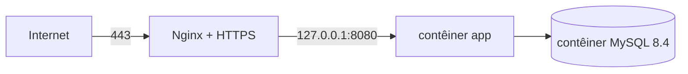

# Servidor na Hostinger (VPS) com Docker e MySQL 8.4

[← Voltar ao README principal](../README.md)

Roteiro para instalar o EcoRedes numa VPS da Hostinger usando os arquivos Docker do repositório
([docker.md](docker.md)) e trazer os dados do servidor atual (MariaDB 10.5, chaves UUID).

| Item | Escolha |
| --- | --- |
| Plano | Hostinger VPS KVM 1 |
| Sistema | Ubuntu 24.04 LTS (imagem limpa) |
| Execução | Docker Engine + Compose: aplicação e MySQL 8.4 em contêineres, dados em volumes |
| Acesso público | Nginx no servidor, com HTTPS (Let's Encrypt), repassando para `127.0.0.1:8080` |
| Backup | `scripts/backup.sh` todo dia, cópia para fora do servidor |



## 1. O plano permite Docker e MySQL 8.4?

A VPS KVM é uma máquina virtual completa, com acesso de administrador (root): é possível instalar o Docker e rodar
a imagem oficial `mysql:8.4`. A confirmação prática, assim que o servidor estiver disponível, é este teste — se ele
passar, o plano atende:

```bash
docker run --rm hello-world
docker run --rm mysql:8.4 mysqld --version          # deve mostrar 8.4.x
free -h && nproc && df -h /                         # memória, processadores e disco disponíveis
```

O uso estimado é pequeno (banco com poucos milhares de registros); a aplicação e o MySQL juntos ocupam algumas
centenas de MB de memória.

## 2. Preparar o servidor

```bash
ssh root@<ip-da-vps>
apt update && apt upgrade -y
adduser equipe && usermod -aG sudo equipe
ufw allow OpenSSH && ufw allow 80 && ufw allow 443 && ufw enable
timedatectl set-timezone America/Sao_Paulo
```

Docker Engine (repositório oficial do Docker):

```bash
curl -fsSL https://get.docker.com | sh
usermod -aG docker equipe
docker compose version
```

Aponte o domínio (registro `A`) para o IP da VPS.

## 3. Instalar o EcoRedes

```bash
sudo mkdir -p /opt/ecoredes && sudo chown equipe:equipe /opt/ecoredes
git clone https://github.com/Oroboni/InsEmpodera.git /opt/ecoredes
cd /opt/ecoredes
cp .env.example .env && nano .env        # troque todas as senhas; APP_URL_PUBLICA=https://<dominio>
chmod 600 .env
docker compose up -d --build
```

Configuração completa, persistência, atualização e comandos: [docker.md](docker.md).

## 4. HTTPS com Nginx

```bash
sudo apt install -y nginx certbot python3-certbot-nginx
sudo tee /etc/nginx/sites-available/ecoredes > /dev/null <<'EOF'
server {
    listen 80;
    server_name <dominio>;
    client_max_body_size 20m;
    location / {
        proxy_pass http://127.0.0.1:8080;
        proxy_http_version 1.1;
        proxy_set_header Host $host;
        proxy_set_header X-Forwarded-For $proxy_add_x_forwarded_for;
        proxy_set_header X-Forwarded-Proto $scheme;
        proxy_set_header X-Forwarded-Host $host;
    }
}
EOF
sudo ln -s /etc/nginx/sites-available/ecoredes /etc/nginx/sites-enabled/
sudo rm -f /etc/nginx/sites-enabled/default
sudo nginx -t && sudo systemctl reload nginx
sudo certbot --nginx -d <dominio>
```

## 5. Migrar os dados do servidor atual

Com o compose no ar e **antes** de liberar o acesso, siga a seção 7 de [docker.md](docker.md):
backup da base antiga com `mariadb-dump --hex-blob`, cópia da pasta `App_Data`, e `scripts/migrar-dados.sh`.
O relatório do script registra cada critério de aceite.

Depois da validação: apague a cópia antiga (`DROP DATABASE empodera_antigo`) e peça a troca de senha dos usuários
reais ([seguranca-dados.md](seguranca-dados.md)).

## 6. Backup diário

```bash
echo "30 2 * * * equipe cd /opt/ecoredes && scripts/backup.sh >> /opt/ecoredes/backups/backup.log 2>&1" | sudo tee /etc/cron.d/ecoredes-backup
```

Copie `/opt/ecoredes/backups` periodicamente para fora da VPS (ou contrate o backup da Hostinger): se a VPS for
perdida, os backups locais vão junto. Teste a restauração ([docker.md](docker.md), seção 6) pelo menos uma vez
antes de liberar o sistema.

## 7. Conferência final (critérios de aceite em produção)

- [ ] Teste da seção 1 aprovado (Docker e MySQL 8.4.x).
- [ ] `https://<dominio>` abre com certificado válido.
- [ ] Relatório da migração aprovado; conferência manual de listagens, cadastros, menções e fotos.
- [ ] Português, inglês e espanhol na tela de login e em Configurações.
- [ ] `docker compose restart` e reinício da VPS não perdem dados nem derrubam o login.
- [ ] Backup gerado, restaurado num teste e copiado para fora da VPS.
- [ ] "Esqueci minha senha" envia o e-mail.
